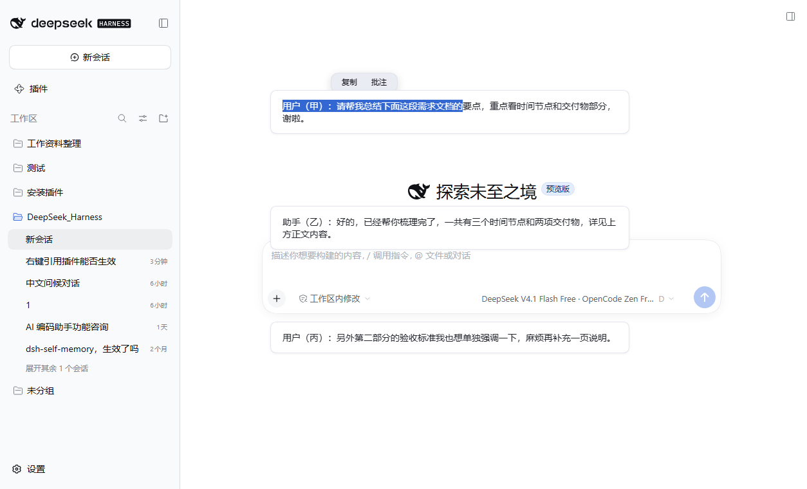
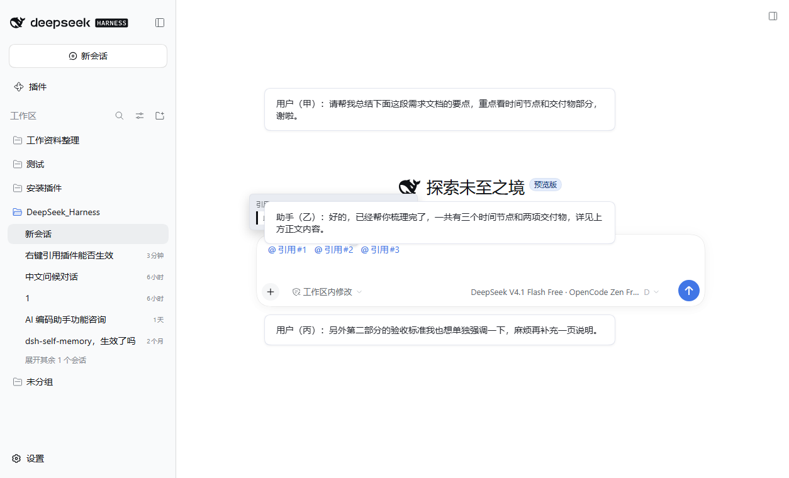
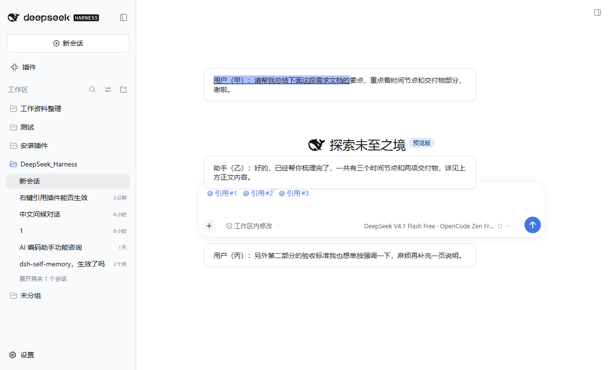

# dsh-quote-annotate

[中文](#功能) | [English](#features)

DeepSeek Harness（DSH）会话交互优化插件：**选中对话中的任意文字 → 一键【复制】或【批注】**，引用以 chip 形式进入输入框，多个引用可共存，发送时展开为结构化引用块，模型精确知道你引用的是哪一段。

> 适配 DSH `0.2.0-rc.2`（含桌面端）。纯 Client 插件，无 Host 逻辑。

---

## 功能

- **选中即出操作条**：拖选会话中的文字，选区上方浮出胶囊按钮条：【复制】【批注】。
- **【复制】**：把选中的原文写入系统剪贴板；气泡随即消失，屏幕顶部弹出「已复制到剪贴板 ✓」。
- **【批注】**：把该段原文作为引用 chip（`@引用#N`）写进底部输入框，光标自动回到输入框，可直接继续输入追问。
- **多个引用共存**：可以连续批注多段文字，多个 chip 同时保留在输入框中（编号递增、不回收）。
- **悬停 chip** → 提示框显示「引用#N」标题 + 当时选中的原文。
- **chip 右上角 ✕** → 精确删除这一条引用，其它 chip 与编号不受影响。
- **点击 chip** → 平滑滚动回原文位置，并**精确高亮当时选中的那一段**（CSS Highlights API，约 2.4 秒后自动消退）。
- **提交序列化**：发送时每个 chip 展开为 `> 引用块`，模型收到的评论精确锚定在原文上。

### 界面示意

**选中即出操作条 | Selection action bar**



**多引用共存 + 悬停原文 | Multiple chips & hover tooltip**



**点击 chip 精确跳回原文 | Click a chip to jump back & highlight**



## 安装

### 方式一：从 GitHub 安装

```sh
dsh plugin --profile <你的profile> add github:everydayfighting/dsh-quote-annotate
```

### 方式二：从 tarball 安装

下载 `dsh-quote-annotate-0.2.0.tgz` 后：

```sh
dsh plugin --profile <你的profile> add file:D:/path/to/dsh-quote-annotate-0.2.0.tgz
```

安装后**完全退出并重启 DSH**（静态客户端插件在服务启动时加载）。

> 桌面端（Electron）用户请使用 DSH 自带的内置命令或应用内插件管理页安装；npm 全局 CLI 会拒绝管理桌面 profile，这是官方设计。

## 已知限制

- 引用 → 原文位置 的映射保存在浏览器内存中，**刷新页面后失效**：此时悬停会提示「原文映射已失效」，点击会提示「找不到该引用的原文」。
- 引用编号（引用#1、引用#2…）只增不回收；删除某条后，其余编号保持不变。
- 需要 DSH 内置的 `ui-input-trigger` 引用管线（官方 web 桌面界面自带）；缺失时自动退化为纯文本引用插入。

## 与上游 0.1.1 的差异

本仓库相对原作者 `wangwei-wade/dsh-quote-annotate@0.1.1` 的主要修正与增强（均针对 DSH 0.2.0-rc.2 实测）：

1. **bundle 行 id 与 client 注册 id 不一致** → 启动图按行 id 索引，模块永远无法到达；已改为 id = 包名。
2. **client bundle 未声明 `inject: ['slots']`** → `apply` 早于服务就绪被调用后静默返回；已声明依赖。
3. **回合尾插槽注册缺少 `id`** → 抛 `list slot ... requires options.id`，中断同一 `apply` 内后续全部 `shell.overlay` 注册；已补 id。
4. **会话解析读取不存在的字段** → 按 `uiWorkspace` 导航状态解析当前会话，多级回退。
5. **插入坐标体系用错** → `insertReference` 需要 detect 坐标（chip 占 1 个 U+FFFC），原实现用 clipboard 投影长度导致第二个 chip 必然失败并抹掉已有 chip；已改用官方 `caretSpan()`。
6. **删除单条引用** → 通过官方 `consumeToken({kind:'span'})`（detect 坐标由 occurrences 折叠换算），互不影响其它 chip。
7. **交互增强**：新增【复制】按钮；点击 chip 跳转并精确高亮选中的那一段（偏移校验 + 跨节点文本搜索兜底 + 多次滚动校正）；悬停显示原文；chip 右上角删除。

## 工作原理（简）

- 纯 Client 插件：`dsh.client.platform = "web"`，浏览器半区经 `window.__ModuleLoader__.load` 注册。
- 通过 `ctx.slots` 注入 `shell.overlay`（操作条 / 提示 / toast / chip 删除按钮）与 `conversation.chat.turnTail`（回合级引用按钮）。
- 引用经官方 `inputTriggers.registerSource`（source 名 `quote-ref`）注册 codec：提交时 chip 由官方展开为引用块；点击 chip 由官方回调 `openReference`。

## English

### Features

- **Selection action bar**: drag-select any text in the conversation — a compact pill bar with **Copy** and **Annotate** appears above the selection. See the screenshots above.
- **Copy**: writes the selected text to the system clipboard; the bar dismisses and a "copied ✓" toast appears at the top of the window.
- **Annotate**: inserts the selected text as a reference chip (`@引用#N`) into the composer and refocuses it, so you can keep typing your follow-up.
- **Multiple chips coexist**: annotate several passages; chips accumulate in the composer (numbers increase, never recycled).
- **Hover a chip** → a tooltip shows the label and the exact original text.
- **✕ at the chip's top-right corner** → removes exactly that reference; other chips and their numbers are untouched.
- **Click a chip** → smooth-scrolls back to the source and **precisely highlights the selected span** (CSS Highlights API, fades after ~2.4s).
- **Serialized on submit**: every chip expands into a `> quote block`, so the model knows exactly which passage you refer to.

### Install

```sh
dsh plugin --profile <your-profile> add github:everydayfighting/dsh-quote-annotate
```

or from a downloaded tarball:

```sh
dsh plugin --profile <your-profile> add file:/path/to/dsh-quote-annotate-0.2.0.tgz
```

Fully quit and restart DSH after installing (static client plugins load at service startup).

### Compatibility notes

- Built and tested against DSH `0.2.0-rc.2` (desktop included). Pure client plugin, no host logic.
- Requires the built-in `ui-input-trigger` reference pipeline (shipped with the official web UI); falls back to plain-text quotes when absent.
- The ref → source-position map lives in browser memory and is lost on page refresh; chips then show an explicit "map expired" notice instead of failing silently.

### Changes vs upstream 0.1.1

Key fixes that make this work on DSH 0.2.0-rc.2 (each verified in a live browser):

1. Bundle row id now equals the package name (the boot graph indexes factories by row id).
2. The client bundle declares `inject: ['slots']` so `apply` no longer runs before the slots service exists.
3. The turn-tail slot registration carries an `id` (list slots throw without one, which aborted every later `shell.overlay` registration).
4. Current session resolution goes through the `uiWorkspace` navigation state with layered fallbacks.
5. Chip insertion uses **detect coordinates** via the official `caretSpan()` (chips occupy one `U+FFFC` in the detect projection; the old clipboard-projection length made the second insertion always fail and wipe existing chips).
6. Removing a single chip goes through the official `consumeToken({kind:'span'})` with detect coordinates folded from `occurrences`.

## License

MIT
